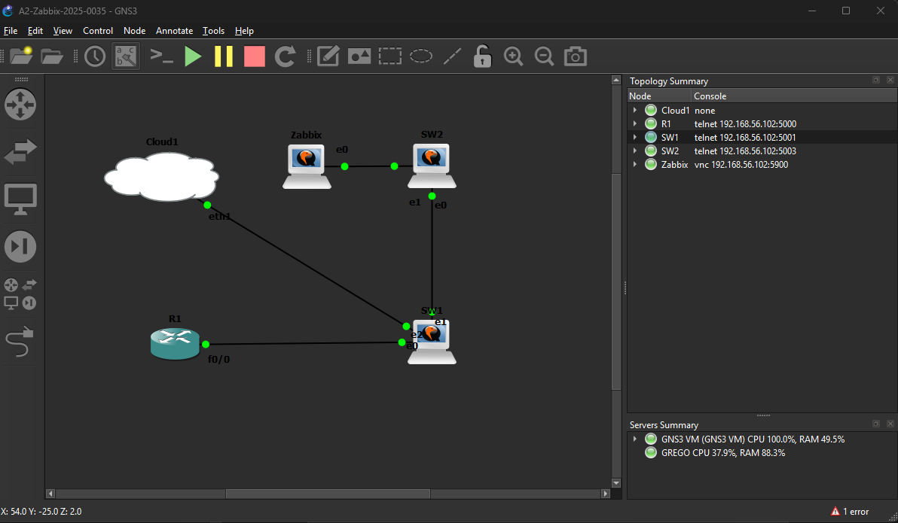
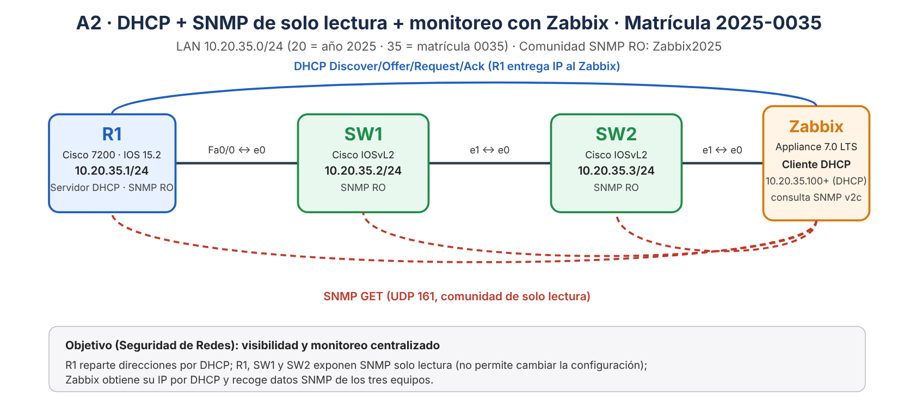
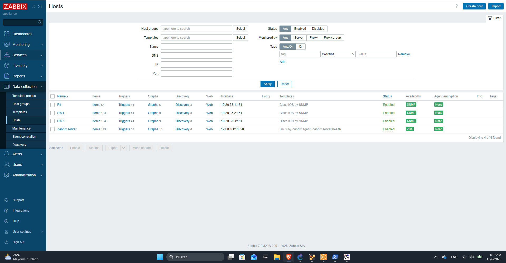
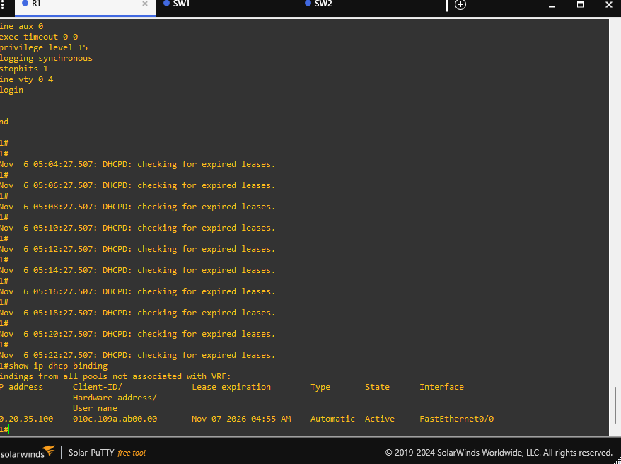
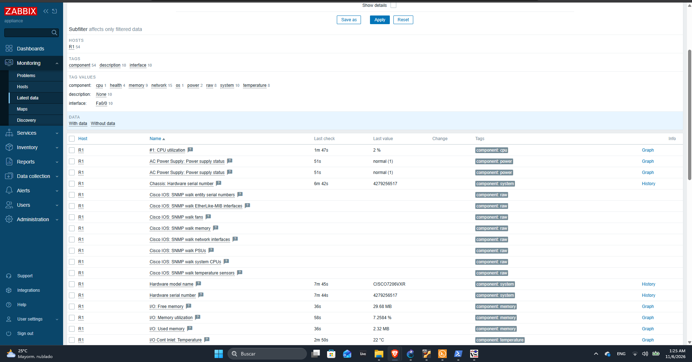
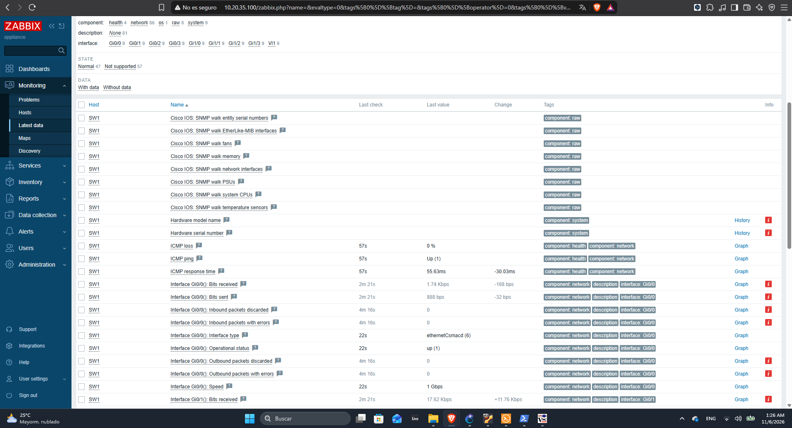

# A2 · DHCP + SNMP de solo lectura + monitoreo con Zabbix

> ▶️ **Video de la demostración:** _(pendiente: pegar aquí el enlace de YouTube)_

**Estudiante:** Gregorys Morel Duluc · **Matrícula:** 2025-0035 · **Materia:** Seguridad de Redes · **ITLA**

---

## 1. Propósito del laboratorio

Montar una pequeña infraestructura de red con **monitoreo centralizado**:

- Un **router Cisco (R1)** que direcciona la LAN y actúa como **servidor DHCP**.
- Dos **switches Cisco (SW1 y SW2)** con direccionamiento IP de gestión.
- **SNMP v2c de solo lectura (RO)** en R1, SW1 y SW2: el servidor de monitoreo puede *consultar* información (estado, tráfico, CPU, interfaces) pero **no puede modificar** la configuración de los equipos.
- Un servidor **Zabbix** que obtiene su dirección IP **por DHCP** (cliente DHCP de R1) y recolecta por SNMP los datos de R1, SW1 y SW2.

Desde el punto de vista de seguridad, SNMP de solo lectura da visibilidad (monitoreo, detección de caídas y saturación) sin exponer la capacidad de escritura sobre los equipos.

## 2. Topología y direccionamiento (basado en la matrícula)

**Topología en GNS3** (R1 – SW1 – SW2 – Zabbix; el nodo *Cloud* en SW1 conecta la PC para abrir la web de Zabbix):



**Diagrama lógico** (direccionamiento, flujo DHCP y consultas SNMP):



El direccionamiento se deriva de la matrícula **2025-0035**: red **10.20.35.0/24** → `20` = año de la matrícula (2025) y `35` = número de la matrícula (0035).

| Equipo | Rol | Interfaz | IP | Máscara |
|---|---|---|---|---|
| R1 | Router Cisco 7200 (IOS 15.2) · servidor DHCP · SNMP RO | Fa0/0 | 10.20.35.1 | /24 (255.255.255.0) |
| SW1 | Switch Cisco IOSvL2 · SNMP RO | Vlan1 | 10.20.35.2 | /24 (gateway 10.20.35.1) |
| SW2 | Switch Cisco IOSvL2 · SNMP RO | Vlan1 | 10.20.35.3 | /24 (gateway 10.20.35.1) |
| Zabbix | Appliance Zabbix 7.0 LTS · **cliente DHCP** | eth0 | 10.20.35.100 (entregada por DHCP) | /24 (gateway 10.20.35.1) |

**Pool DHCP:** `10.20.35.100 – 10.20.35.254` (las direcciones `.1` a `.99` están excluidas para equipos de infraestructura). **Comunidad SNMP de solo lectura:** `Zabbix2025`.

Entorno: GNS3 2.2 + GNS3 VM (VirtualBox). El servidor Zabbix es el appliance oficial (QEMU) dentro de GNS3. Un nodo *Cloud* en SW1 conecta la PC anfitriona a la LAN para abrir la interfaz web de Zabbix.

## 3. Cumplimiento de los requisitos

| # | Requisito del enunciado | Cómo se cumple | Evidencia |
|---|---|---|---|
| 1 | Direccionamiento IP en Router y Switches | R1 Fa0/0 = 10.20.35.1; SW1/SW2 en Vlan1 = .2 y .3, con gateway al router | [R1](configs/R1-running-config.txt) · [SW1](configs/SW1-running-config.txt) · [SW2](configs/SW2-running-config.txt) |
| 2 | **Servidor DHCP** para la LAN | `ip dhcp pool LAN-2025-0035` en R1, con direcciones excluidas y gateway | [R1-config.txt](scripts/R1-config.txt) |
| 3 | **SNMP** de solo lectura | `snmp-server community Zabbix2025 RO` en R1, SW1 y SW2 | [scripts](scripts/) |
| 4 | Zabbix como **cliente DHCP** | El appliance recibe 10.20.35.100 de R1 (binding visible en R1) | [Imagen 3](img/03-r1-dhcp-binding.png) |
| 5 | Verificar datos SNMP en Zabbix (Router y Switch) | Los 3 hosts con SNMP en verde y datos en *Latest data* | [Imagen 2](img/02-zabbix-hosts-snmp.png) · [Router: imagen 4](img/04-zabbix-latest-data.png) · [Switch: imagen 6](img/06-zabbix-latest-data-sw1.png) |
| 6 | Scripts y running-configs | Carpetas `scripts/` y `configs/` | ver abajo |
| 7 | Video con fecha/hora, cara y voz (≤ 10 min) | Enlace al inicio de este README | — |

## 4. Configuración

### 4.1 R1 — DHCP + SNMP RO ([scripts/R1-config.txt](scripts/R1-config.txt))

```
interface FastEthernet0/0
 ip address 10.20.35.1 255.255.255.0
 no shutdown
ip dhcp excluded-address 10.20.35.1 10.20.35.99
ip dhcp pool LAN-2025-0035
 network 10.20.35.0 255.255.255.0
 default-router 10.20.35.1
 dns-server 8.8.8.8
 lease 1
snmp-server community Zabbix2025 RO
snmp-server location Lab-ITLA-2025-0035
snmp-server contact gregorys.morel
```

### 4.2 SW1 y SW2 — IP de gestión + SNMP RO ([SW1](scripts/SW1-config.txt) · [SW2](scripts/SW2-config.txt))

```
interface vlan 1
 ip address 10.20.35.2 255.255.255.0     ! SW2: 10.20.35.3
 no shutdown
ip default-gateway 10.20.35.1
snmp-server community Zabbix2025 RO
```

### 4.3 Zabbix — alta de los equipos por SNMP

Los tres equipos se registraron en Zabbix con interfaz **SNMP v2c** (comunidad `Zabbix2025`, puerto 161) y la plantilla **Cisco IOS by SNMP**, mediante la API de Zabbix: [scripts/zabbix-alta-hosts.ps1](scripts/zabbix-alta-hosts.ps1). El equivalente manual es *Data collection → Hosts → Create host*.

## 5. Evidencia

**Zabbix — R1, SW1 y SW2 monitoreados por SNMP (icono SNMP en verde):**



**R1 — `show ip dhcp binding` (Zabbix recibió su IP por DHCP):**



**Zabbix — Monitoring → Latest data de R1 (router; modelo, CPU, memoria, temperatura):**



**Zabbix — Monitoring → Latest data de SW1 (switch; estado y tráfico de las interfaces por SNMP):**



## 6. Verificación

Comandos usados en R1 ([scripts/R1-verificacion.txt](scripts/R1-verificacion.txt)):

```
show ip dhcp binding
show snmp community
show running-config
```

## 7. Estructura del repositorio

```
├── README.md
├── img/        diagrama y capturas
├── configs/    running-config de R1, SW1 y SW2
└── scripts/    comandos de configuración y script de alta en Zabbix
```
